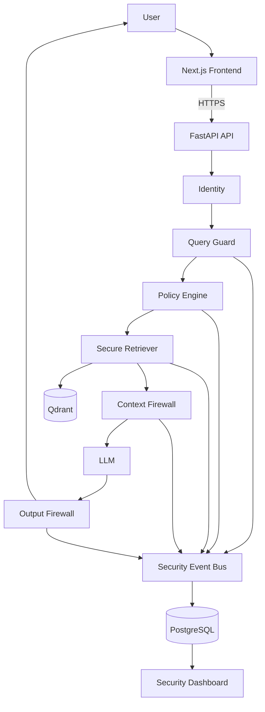
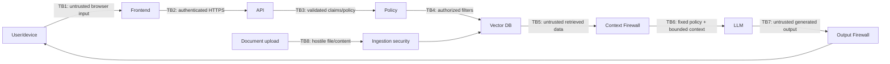
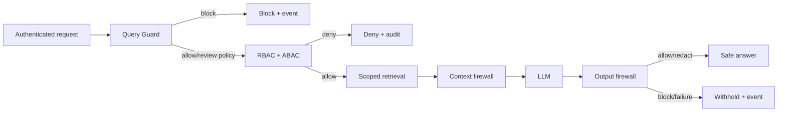
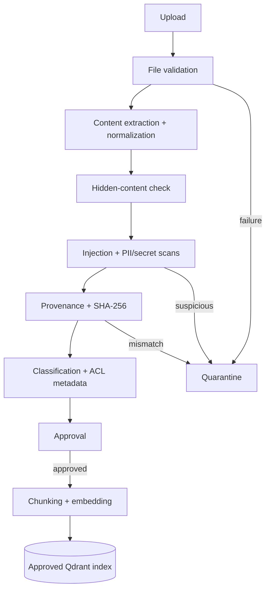
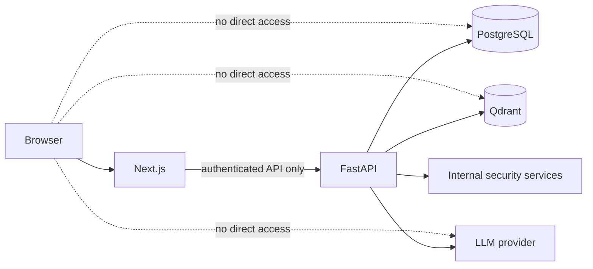
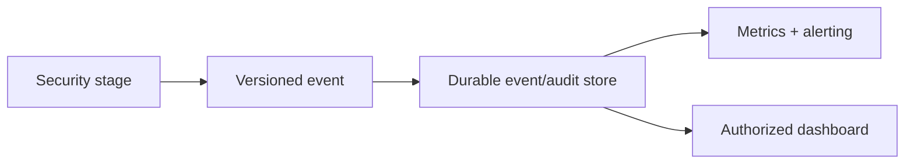
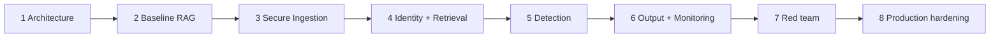

# Architecture

RAGFort uses zero trust and defense in depth: all input, documents, context, and output are untrusted. The browser communicates only with the API; privileged data and model calls are server-side. Security enforcement is deterministic; detection is evidence-producing and may invoke a configured block, never authorization.

## High-level architecture

## Trust boundaries

## Query lifecycle

## Secure document lifecycle (Phase 3 design)

## Service connection model

## Event flow and roadmap

## Failure policy

Auth, authorization, policy, malformed ACL/tenant, integrity, context security, output security, and security-event persistence fail closed (deny/quarantine/withhold). Vector or LLM outage returns a generic safe availability error—never an ungoverned model-only fallback. `/health/live` is process-only; readiness is minimal and internal/protected in production.
