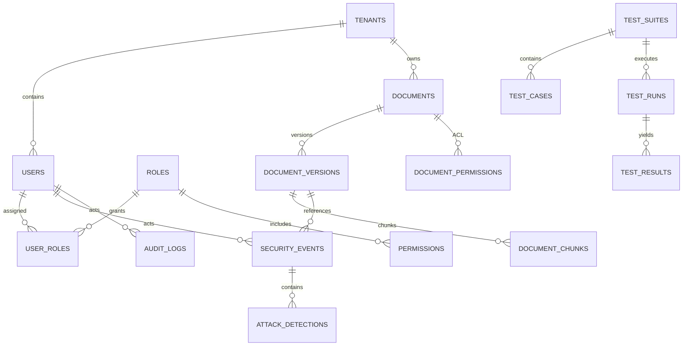

# Data Model

PostgreSQL is the planned source of truth for tenant, policy, document lifecycle, security evidence, and audit metadata. Qdrant holds derived embeddings only; it is not the authorization authority.

Future entities: `tenants`, `users`, `roles`, `permissions`, `user_roles`, policy attributes/assignments; `documents`, `document_versions`, `document_chunks`, `document_permissions`; `security_events`, `attack_detections`, `retrieval_logs`, `model_requests`, `audit_logs`, `blocked_requests`, `quarantined_documents`; and `test_suites`, `test_cases`, `test_runs`, `test_results`.

Every tenant-owned row includes `tenant_id`; later PostgreSQL RLS supplements (never replaces) server-side predicate enforcement. Documents are versioned, hash-bound, classified, provenance-bound, and stateful. Deletion is a tombstone-and-purge workflow that records completion for object source, relational data, vectors, and caches.

Security events are append-oriented with `event_id`, `request_id`, `correlation_id`, UTC timestamp, schema version, stage, category, severity, risk score, action, pseudonymous tenant/actor references, policy/version, detector signals, retrieval/LLM/exposure booleans, outcome, and latency. Raw prompts, documents, outputs, secrets, and PII are excluded by default; protected evidence is a separate access-controlled reference.
