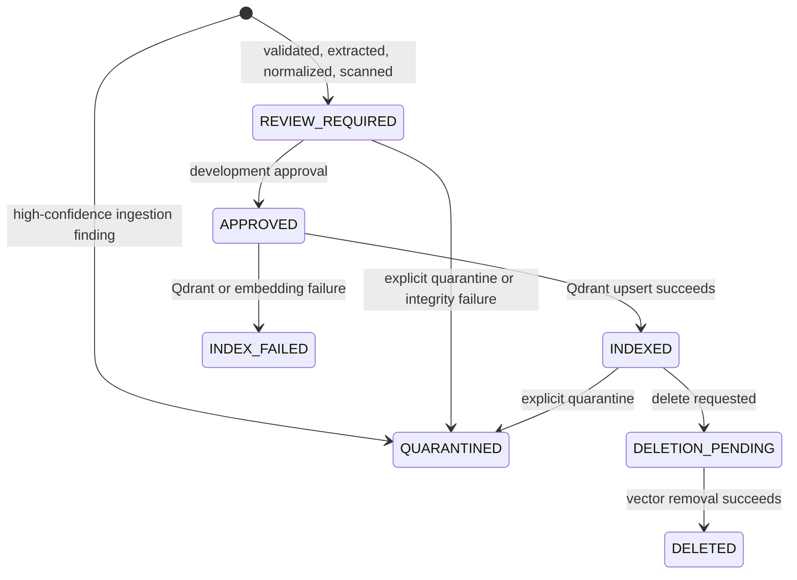

# Document lifecycle

Only `APPROVED` reaches the index writer, and only a successful upsert produces `INDEXED`. Rejected/unsupported files never create an index entry. A duplicate original SHA-256 returns the existing version. A changed safe display name creates a new version for the same logical document; approval never transfers automatically. Integrity verification before approval quarantines a changed version. Delete first marks a non-active pending state and reports `DELETED` only after vector deletion completes.

The authoritative records are `documents` and immutable `document_versions` in PostgreSQL/SQLAlchemy. They contain lifecycle state, controlled classification, detected type, byte count, provenance-safe filename, original and normalized hashes, safe findings, original bytes, normalized text, and index state. Raw bodies are not returned by document APIs or logged.
