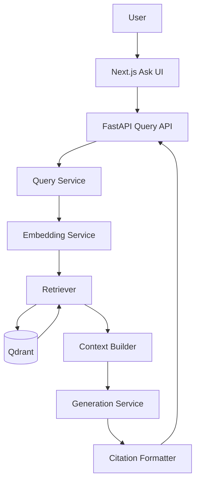
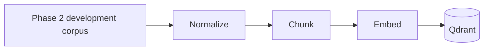
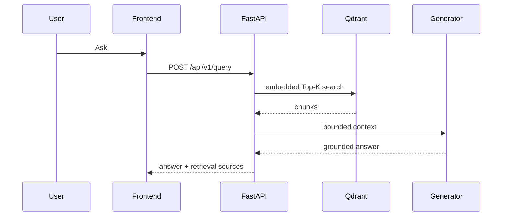

# RAGFORT — PHASE 2 IMPLEMENTATION REPORT

## 1. Context

Phase 1 froze the zero-trust architecture at `phase-1-complete`. Phase 2 builds the first explicit RAG vertical slice over a controlled 20-document synthetic corpus. Secure ingestion, identity, authorization, attack detection, output DLP, and observability remain deferred.

## 2. Introduction

Documents are normalized and chunked, embedded, and indexed as a derived Qdrant search index. A question is embedded, retrieved with optional server-owned filters, converted into a bounded `ContextPackage`, passed to a generation protocol, and returned with citations originating from retrieval metadata.

## 3. Tech Stack

| Technology | Version | Purpose and tradeoff |
|---|---:|---|
| FastAPI/Pydantic | existing Phase 1 ranges | Typed API and safe envelopes; explicit boundaries. |
| qdrant-client/Qdrant | 1.19 / Compose 1.13.4 | Derived cosine vector index with payload filters; adds a service. |
| HashEmbeddingService | 256 dimensions | Reproducible local/CI baseline; not production semantic-model quality. |
| Next.js/React | 15.3.2/19.1.0 | Accessible Ask UI; browser only calls FastAPI. |
| pytest/Ruff | existing ranges | Tests and static checks. |

## 4. Objective

Provide a measurable, testable RAG path while retaining separate embedding, retrieval, context, generation, and citation boundaries for later policy/firewall controls.

## 5. Problem

The implementation had to preserve document identity, bound context, avoid invented citations, represent no-evidence separately from outage, and avoid model-only fallback. The selected deterministic fixture corpus and adapter architecture keep each decision reproducible.

## 6. Solution

`DocumentChunker` → `HashEmbeddingService` → `QdrantRetriever` indexes the development corpus. `QueryService` orchestrates query embedding → retrieval → `ContextBuilder` → `ExtractiveGenerationService` → `CitationFormatter`. `POST /api/v1/query` maps known failures to safe envelopes. The Ask UI has a centralized API client and success, loading, insufficient-context, and safe-error states.

## 7. How We Resolved It / Techniques and Approaches

Deterministic IDs use SHA-256 document/version/index. Context uses complete chunks and a token estimate. Retrieval filters are accepted now but only future server policy will derive them. The generator never creates citations; citations are deduplicated retrieval metadata. Empty retrieval skips generation; retrieval failure raises `RAG_RETRIEVAL_UNAVAILABLE` without fallback. Unit, API, and in-memory-Qdrant integration tests cover these properties.

## 8. Visuals and Diagrams







Phase 2 is Query → Retrieval → Context → LLM/provider → Answer. Phase 4 inserts identity/policy/ACL filters, Phase 5 query/context detection, and Phase 6 output firewall/monitoring.

```text
┌──────────────────────────────────────────────────────────────┐
│ RAGFort                                                      │
├───────────────┬──────────────────────────────────────────────┤
│ ● Ask         │ Ask your knowledge base                      │
│ Documents*    │ [ What would you like to know?             ] │
│ Security*     │                         [ Ask → ]            │
│ Activity*     │ Answer and retrieved source cards            │
│ Tests*        │ Grounded in N sources                        │
│ Settings*     │ *Future phase                                │
└───────────────┴──────────────────────────────────────────────┘
```

## 9. Result

**Implemented:** controlled corpus, chunker, deterministic embeddings, Qdrant adapter, bounded context, extractive grounded provider, retrieval-derived citations, query API, Ask UI, evaluation runner, and tests. **Designed:** a sentence-transformer/OpenAI-compatible adapter path. **Deferred:** all Phase 3+ security controls.

## 10. Output

Measured evaluation: 20 documents/20 chunks, average chunk size 153.15 characters, 256 dimensions, cosine/dot normalized vectors. At K=5: Precision@K 0.20, Recall@K 1.0, Hit Rate@K 1.0, MRR 0.9; exact run latency evidence is versioned in `evaluation/results/phase2-retrieval.json`. Citation mapping: tested retrieval-derived only. E2E generation latency: **NOT MEASURED**. Docker Qdrant benchmark: **NOT MEASURED** because Docker Desktop daemon was unavailable.

Endpoint matrix: Ask → `POST /api/v1/query`; readiness → `GET /health/ready`; sources are in the query response. All other UI API endpoints are **NOT IMPLEMENTED — FUTURE PHASE**.

Final security review: no browser Qdrant/LLM client, no frontend secret config, no raw environment endpoint, no model-only fallback, explicit filters/context/generation/citation boundaries, and no Phase 1 invariant contradiction found. UI build and TypeScript lint pass.

## Completion status

**Status: PARTIAL.** Baseline RAG, Retrieval, Generation, Citations, API, Frontend, Evaluation, and Testing are functionally implemented and tested. Reliability and Git completion gates are **PARTIAL** because the required Docker-hosted Qdrant seed/manual failure run could not execute while Docker Desktop is unavailable. `phase-2-complete` was intentionally not created. Start Docker Desktop, run `docker compose up -d qdrant`, `python -m backend.scripts.seed_corpus --reset`, then repeat the documented API/UI and outage checks before requesting final Phase 2 closure. Phase 3 is not started.
