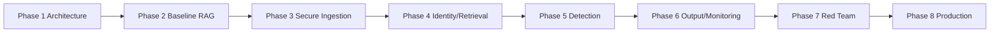
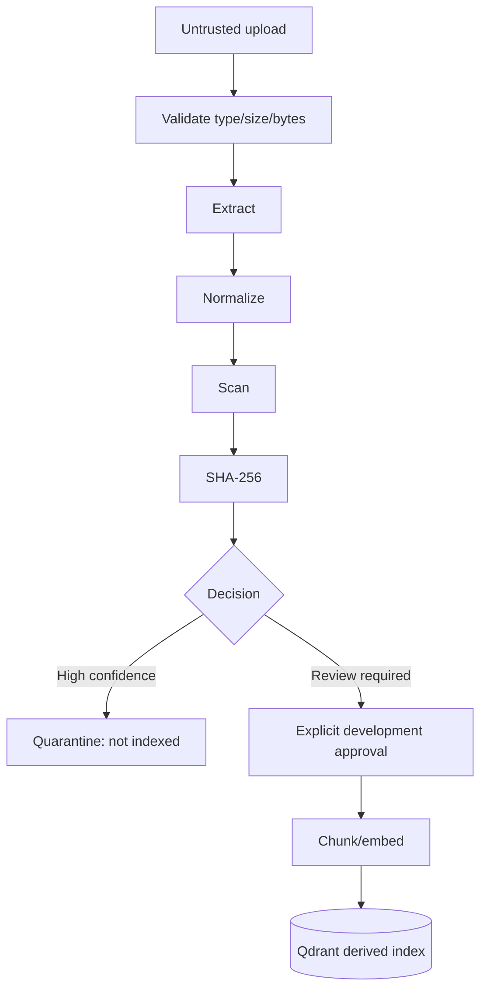
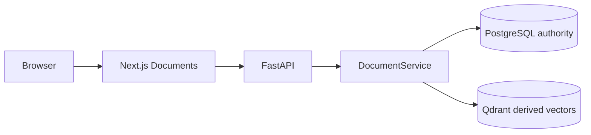

# RAGFORT - PHASE 3 IMPLEMENTATION REPORT

## 1. Context

Phase 1 defined the zero-trust architecture and Phase 2 froze the explicit baseline RAG path at `phase-2-complete`. Phase 3 adds the boundary that treats uploaded content as untrusted until it is validated, scanned, integrity-recorded, reviewed, explicitly approved, and successfully indexed. Identity, RBAC/ABAC, tenant enforcement, broad attack detection, output DLP, and production hardening remain future work.

## 2. Introduction

An attacker can poison RAG through a document rather than a query. The implemented ingestion path is `upload -> file validation -> extraction -> NFKC normalization -> deterministic content/sensitive scan -> SHA-256 -> controlled classification -> review/quarantine -> approval -> chunk/embed -> Qdrant`. PostgreSQL/SQLAlchemy state is authoritative; Qdrant is derived and receives no unapproved version.

## 3. Tech Stack

| Technology | Version | Purpose, alternatives, and implications |
|---|---:|---|
| FastAPI/Pydantic | existing ranges | Typed safe upload/API boundary; Django was not needed. |
| SQLAlchemy/PostgreSQL | 2.0/16 | Durable lifecycle authority; SQLite is used only in disposable tests. Adds a service. |
| Qdrant | 1.19 | Derived vectors with payload deletion/filtering; never lifecycle authority. |
| python-multipart | 0.0.x | Bounded multipart upload parsing. |
| HashEmbeddingService | 256 dimensions | Reproducible development index; not a production semantic-quality claim. |

## 4. Objective

Deliver a testable secure document lifecycle: narrow allowlist, safe extraction, normalization, deterministic scanning, provenance, original/content SHA-256, controlled classification, review/approval/quarantine, approved-only indexing, deletion propagation, safe APIs, Documents UI, and Phase 2 regression preservation.

## 5. Problem

| ID | Attack scenario | Impact | Required control |
|---|---|---|---|
| P3-01/02 | Malformed, oversized, spoofed, or unsupported upload | Parser abuse/bypass | Byte limit, allowlist, signature/text consistency. |
| P3-03/05 | Indirect instruction or hidden Unicode | Future context manipulation | Normalize and deterministic high-severity quarantine. |
| P3-04/15 | Poisoning/version confusion | Untraceable false knowledge | Version/hash/provenance and explicit approval. |
| P3-06 | Sensitive data fixture | Unsafe later exposure | Minimized review finding, no raw evidence API/log. |
| P3-07 | Stored content tampering | Active untrusted vector | Hash recheck and quarantine. |
| P3-08/09 | Replay/unapproved indexing | Uncontrolled searchable content | Duplicate SHA-256 handling and index gate. |
| P3-12/14 | Index/delete partial failure | Stale or falsely active vector | `INDEX_FAILED`/`DELETION_PENDING` states and Qdrant removal. |

## 6. Solution

Preventive controls are allowlist/size/signature checks, safe names, parser boundary, controlled classification, hashes, state transitions, and approval-only indexing. Detective controls are instruction, hidden-Unicode, and sensitive-pattern findings. Corrective controls are reject, review, quarantine, index-failed state, and vector deletion. Integrity controls are dual SHA-256. Lifecycle controls persist document/version state. UI controls expose only safe summaries/findings and clear human-safe errors.

## 7. How We Resolved It / Techniques and Approaches

Allowlists were selected over blocklists; browser MIME remains advisory. Original bytes are preserved for integrity while the normalized representation is scanned. High-confidence instruction/hidden controls quarantine, while sensitive-like patterns require review. The generator never controls citations or ingestion state. Indexing calls the existing explicit chunker/embedding/retriever only after a durable approval transition; Qdrant failure leaves `INDEX_FAILED`. Tests prove the critical negative paths listed below. The tradeoff is manual development approval and limited format/scanner coverage.

## 8. Visuals and Diagrams

See [document-lifecycle.md](document-lifecycle.md) for the state diagram. UI wireframe: `Documents | Upload document | Name / classification / status | selected detail: findings, index state, approve/quarantine/delete`.

## 9. Result

**Implemented/tested:** durable document/version records; TXT/Markdown validation; bounded UTF-8 extraction; NFKC and hidden-Unicode detection; deterministic suspicious-instruction and sensitive-like scanning; SHA-256; review/quarantine/approval/index/delete states; approved chunk metadata; document API; Documents UI; Docker PostgreSQL; 18 automated tests; and live Compose upload/approval/retrieval/quarantine/deletion evidence.

**Measured:** 1 MB upload cap; 20 Phase 2 baseline documents retained; safe upload indexed after approval and returned a retrieval-derived citation; malicious fixture returned `QUARANTINED` and did not appear as a retrieved source; sensitive fixture returned `REVIEW_REQUIRED`; deletion removed the derived source.

**Designed/deferred:** Phase 4 identity/tenant/ABAC and migrations; Phase 5 richer scanners/context firewall; Phase 6 output DLP/telemetry; Phase 7 red-team coverage. Scanner coverage is intentionally pattern-limited, and no universal injection/DLP claim is made.

## 10. Output

Backend additions: `backend/app/documents/` lifecycle, persistence, and ingestion service; document endpoints; Qdrant vector deletion. Frontend additions: centralized `api/documents.ts` and `/documents` UI. Infrastructure: PostgreSQL Compose service with internal trust only, no host port. Dependencies: SQLAlchemy, psycopg, python-multipart. Security fixtures: safe, malicious, sensitive synthetic TXT. ADRs: 013-017. Documents: secure-ingestion, lifecycle, API/data/testing/invariant updates.

| Test category | Passed | Failed | Evidence |
|---|---:|---:|---|
| Unit/API/integration | 17 | 0 | `python -m pytest` |
| Phase 2 regression | 10 existing + included suite | 0 | Query tests remain green |
| Frontend | TypeScript/build | 0 | `npm run lint`, `npm run build` |
| Compose runtime | API, Qdrant, PostgreSQL healthy | 0 | `docker compose ps` |
| Live E2E | Safe, malicious, sensitive, delete | 0 | Sanitized API/browser evidence |

### UI/UX Architecture

The Documents route uses the existing calm ivory/serif/orange design. It offers a labelled native file input, actual backend status, safe finding categories, status text plus color, responsive stacked rows, visible focus styles, aria-live upload results, and deliberate confirmation before approval/quarantine/delete. It does not expose raw extracted content, filesystem paths, scanner rule internals, Qdrant details, or secrets. Browser calls are centralized and API-only.

### Endpoint matrix

| UI | Endpoint | Method | Phase 3 assumption | Purpose |
|---|---|---|---|---|
| Documents | `/api/v1/documents` | GET | Development-only | List safe lifecycle summaries |
| Upload | `/api/v1/documents` | POST | Development-only | Validate/scan untrusted upload |
| Detail/security | `/api/v1/documents/{id}` and `/security` | GET | Development-only | Safe detail/findings |
| Actions | `/scan`, `/approve`, `/quarantine`, DELETE document | POST/DELETE | Development-only privileged action | Controlled lifecycle mutation |

## RAGFORT - PHASE 3 COMPLETION REPORT

Status: **PASS**. Phase 2 Regression, Secure Upload, File Validation, Safe Extraction, Normalization, Security Scanning, Sensitive Data Detection, Integrity, Provenance, Classification, Approval, Quarantine, Index Gating, Deletion, Backend, Frontend, API, Database, Qdrant, Security Tests, E2E, Docker, Secrets Review, and Git are PASS for the explicitly limited Phase 3 scope. Known risks: TXT/Markdown only; deterministic scanner patterns do not establish universal injection or sensitive-data prevention; `create_all` is a development schema bootstrap and formal migrations remain future work; development approval is not authentication or authorization. Deferred to Phase 4: trusted identity, tenant isolation, RBAC/ABAC, and secure retrieval filters. Phase 4 readiness: **READY**. Phase 4 is **NOT STARTED**.
