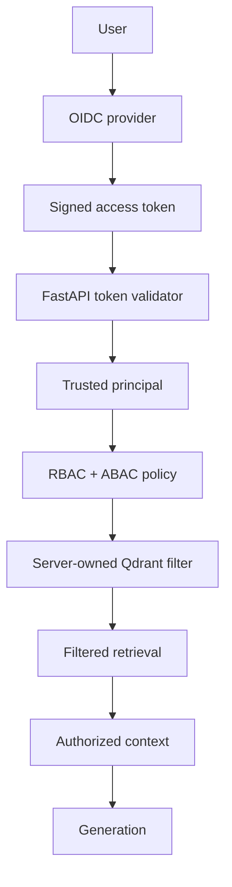

# RAGFort Phase 4 implementation report

## 1. Context

Phase 4 begins from the clean `phase-3-complete` checkpoint on branch
`phase-4-identity-secure-retrieval`.  Phase 1 designed the zero-trust boundaries,
Phase 2 established explicit RAG components, and Phase 3 added an approved-only
development ingestion lifecycle.  This phase makes identity, policy, tenant, and
classification authoritative before vector retrieval.

## 2. Introduction

Semantic search ranks related chunks but does not understand identity.  Phase 4
therefore constructs a validated principal, evaluates deterministic RBAC plus ABAC,
and passes only a server-derived filter to Qdrant.  It must never retrieve broadly
and remove unauthorized chunks later.

## 3. Tech Stack

Current runtime dependencies are FastAPI, SQLAlchemy, PostgreSQL, Qdrant, React and
Next.js.  Phase 4 will add only an OIDC/JWT validation library if the existing
dependencies cannot perform standards-compliant asymmetric JWT validation.  Exact
versions and validation evidence are recorded at closure.

## 4. Objective

Deliver an authenticated trusted principal, deterministic RBAC/ABAC policy,
tenant-scoped documents and pre-retrieval Qdrant filtering, plus a minimal
permission-aware browser experience.  Phase 5 detection and Phase 6 output controls
remain out of scope.

## 5. Problem

The inherited Phase 2 fixture index and Phase 3 payloads do not have tenant, ACL,
current-version, or role metadata.  They are not safe to query once access control is
enabled.  The cutover must backfill/reseed security metadata and fail closed for
legacy or malformed points.

## 6. Solution

The proposed path is OIDC token validation → canonical principal lookup → policy
decision → typed server-owned retrieval scope → filtered Qdrant search → authoritative
metadata revalidation → context and generation.  Document APIs receive the same
principal and action-specific policy checks.

## 7. How We Resolved It / Techniques and Approaches

Specialist reviews consolidated the following decisions: use provider-independent
OIDC rather than custom passwords; combine RBAC endpoint permissions with ABAC
tenant/classification/document state/role constraints; source tenant and roles from
the canonical principal, never a request body; use a short token lifetime plus a
database authorization epoch for revocation; and do not introduce a cache in this
phase.

## 8. Visuals and Diagrams

## 9. Result

**In progress.** This document records design evidence only until implementation,
tests, local runtime validation, and a secret review are complete.  No Phase 4
security claim is made yet.

## 10. Output

Initial output: ADR-018 and this implementation report.  The final update will list
source modules, migrations, test evidence, browser validation, exact metrics, commits,
limitations, and Phase 5 readiness.
