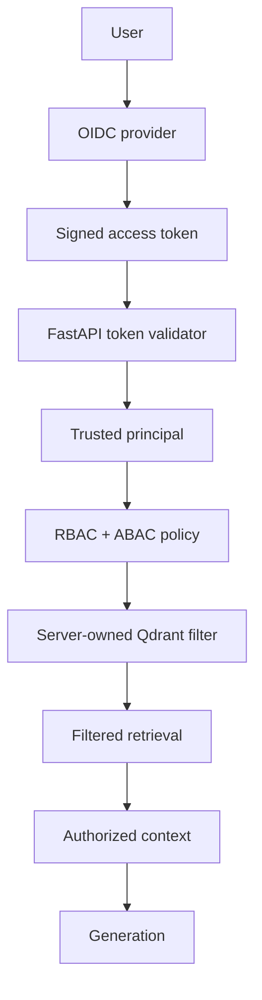

# RAGFort Phase 4 implementation report

## 1. Context

Phase 4 begins from the clean `phase-3-complete` checkpoint on branch
`phase-4-identity-secure-retrieval`.  Phase 1 designed the zero-trust boundaries,
Phase 2 established explicit RAG components, and Phase 3 added an approved-only
development ingestion lifecycle.  This phase makes identity, policy, tenant, and
classification authoritative before vector retrieval.

## 2. Introduction

Semantic search ranks related chunks but does not understand identity.  Phase 4
therefore constructs a validated principal, evaluates deterministic RBAC plus ABAC,
and passes only a server-derived filter to Qdrant.  It must never retrieve broadly
and remove unauthorized chunks later.

## 3. Tech Stack

Current runtime dependencies are FastAPI, SQLAlchemy, PostgreSQL, Qdrant, React and
Next.js.  Phase 4 will add only an OIDC/JWT validation library if the existing
dependencies cannot perform standards-compliant asymmetric JWT validation.  Exact
versions and validation evidence are recorded at closure.

## 4. Objective

Deliver an authenticated trusted principal, deterministic RBAC/ABAC policy,
tenant-scoped documents and pre-retrieval Qdrant filtering, plus a minimal
permission-aware browser experience.  Phase 5 detection and Phase 6 output controls
remain out of scope.

## 5. Problem

The inherited Phase 2 fixture index and Phase 3 payloads do not have tenant, ACL,
current-version, or role metadata.  They are not safe to query once access control is
enabled.  The cutover must backfill/reseed security metadata and fail closed for
legacy or malformed points.

## 6. Solution

The proposed path is OIDC token validation → canonical principal lookup → policy
decision → typed server-owned retrieval scope → filtered Qdrant search → authoritative
metadata revalidation → context and generation.  Document APIs receive the same
principal and action-specific policy checks.

## 7. How We Resolved It / Techniques and Approaches

Specialist reviews consolidated the following decisions: use provider-independent
OIDC rather than custom passwords; combine RBAC endpoint permissions with ABAC
tenant/classification/document state/role constraints; source tenant and roles from
the canonical principal, never a request body; use a short token lifetime plus a
database authorization epoch for revocation; and do not introduce a cache in this
phase.

## 8. Visuals and Diagrams

## 9. Result

**Complete.** Phase 4's identity-secure retrieval boundary is implemented and
validated. Qdrant is a derived candidate index; PostgreSQL is the authoritative
final admission decision for every secured retrieval candidate.

### Runtime evidence recorded September 2, 2026

- Keycloak 26.1.4 is healthy in Docker; OIDC discovery, JWKS retrieval, realm
  provisioning, and real synthetic-user token issuance succeeded.
- PostgreSQL canonical identity resolution was verified with a Keycloak-issued
  ACME Employee token: `GET /api/v1/me` returned HTTP 200, `tenant_acme`, and
  the database-authoritative `viewer` role.
- Authenticated pre-filtered retrieval was verified with the Phase 4 marker
  corpus: ACME → ACME was grounded; ACME → GLOBEX and HR → Finance returned
  `insufficient_context` without citations; Finance Reader → Finance returned
  the authorized finance citation.
- The Docker API image now contains the controlled corpus and the corpus seeder
  resolves its fixture paths independently of the container working directory.
- Full pytest passed: **53 tests**. Ruff, Python compilation, evaluation,
  frontend TypeScript lint/build, and Compose configuration validation passed.

Measured from the runtime marker probes:

| Metric | Result |
| --- | ---: |
| `cross_tenant_leakage` | 0 |
| `forbidden_chunks` | 0 |
| `forbidden_citations` | 0 |

### Browser-session evidence

The local browser flow now uses PKCE authorization code login through Keycloak.
FastAPI exchanges the code and retains the access token only in its local
server-side session store; the browser receives an opaque `HttpOnly`, `SameSite`
cookie and frontend JavaScript never receives a bearer token. Browser automation
verified the unauthenticated sign-in gate, Keycloak login, callback to the
authenticated Ask page, and an ACME grounded answer with its permitted citation.
The in-memory local store is intentionally lost on API restart, which safely
returns the browser to the sign-in gate. Production session persistence and a
distributed revocation store remain Phase 8 work.

The server-held browser session now stores the canonical authorization epoch at
login and compares it with PostgreSQL on every cookie-authenticated request. A
mismatch revokes the opaque session before the route can reach embedding,
retrieval, context building, or generation. Focused session/revocation tests
pass. A live disabled-account probe also returned `200` while active and `403`
after `active=false`, then restored the synthetic account. The complete browser
multi-user revocation/logout matrix remains an explicit closure requirement.

### Browser E2E evidence (September 3, 2026)

- ACME Employee completed a real Keycloak PKCE login and received a grounded
  answer with an ACME citation for `FALCON-AMBER-731`.
- The same browser session queried `COBALT-RIVER-942` and received the safe
  insufficient-context state with no source card, confirming that no GLOBEX
  evidence was disclosed in that UI flow.
- ACME HR Reader queried `FINANCE-ORCHID-815` and received the same safe
  insufficient-context state with no Finance citation. ACME Finance Reader
  previously received the authorized Finance answer and citation.
- The real browser sign-out control removed the opaque session. The app returned
  to the sign-in gate and a same-browser `GET /api/v1/me` returned `401
  UNAUTHENTICATED`.
- A live browser session was invalidated after its PostgreSQL
  `authorization_epoch` changed; revisiting the application returned the user to
  the sign-in gate before a protected query could run.

These results retain the measured retrieval-security values:
`cross_tenant_leakage = 0`, `forbidden_chunks = 0`, and
`forbidden_citations = 0` for the controlled marker corpus.

### Final stale-vector lifecycle evidence (September 21, 2026)

The final lifecycle consistency regression uses the real `DocumentService`,
SQLite-backed document/version persistence, in-memory Qdrant adapter, server-owned
`RetrievalScope`, PostgreSQL authoritative validator, and `QueryService`.

- A fault-injected Qdrant deletion failure leaves the original point searchable
  directly in Qdrant after both quarantine and delete requests.
- PostgreSQL records `QUARANTINED` for quarantine and the established safe
  `DELETION_PENDING` state for a failed delete-index operation. Both states are
  non-retrievable.
- The secured path removes those stale candidates before context construction;
  the marker has no answer and no citation. A separate current `INDEXED` document
  remains grounded and cited.
- The validator is a single batched PostgreSQL join over candidate version IDs.
  It requires current document/version state, tenant, lifecycle/index state,
  classification, semantic ACL equivalence and authorization, department snapshot,
  and authorization-metadata version. PostgreSQL validation failure produces
  `RetrievalUnavailableError`; it never returns a model-only fallback.

Final local release checks passed: **61 pytest tests**, Ruff, Python compilation,
retrieval evaluation, frontend TypeScript lint/build, and Compose configuration.
The security marker matrix retains `cross_tenant_leakage = 0`,
`forbidden_chunks = 0`, and `forbidden_citations = 0`.

An independent authorization review passed, confirming the predicate, lifecycle
regression, and fail-closed behavior prove the existing stale-vector invariant.

## 10. Output

Initial output: ADR-018 and this implementation report.  The final update will list
source modules, migrations, test evidence, browser validation, exact metrics, commits,
limitations, and Phase 5 readiness.

Runtime commits during this block include local Keycloak profile/client fixes,
container corpus fixes, and classified department-reader policy wiring. The
`phase-4-complete` tag records this closure checkpoint.
