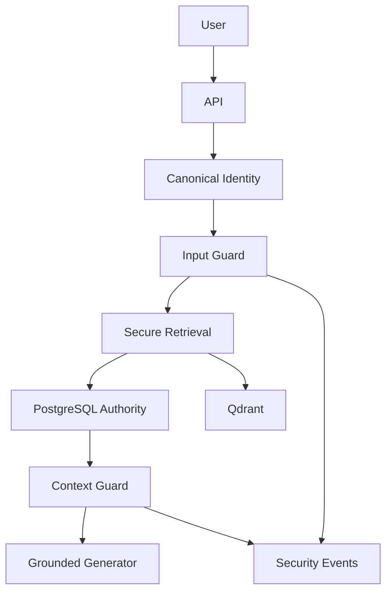

# RAGFort Phase 5 threat model

## Scope and assumptions

Scope is the authenticated query path, its authorized retrieved context, and
minimized security evidence. The deployment is a multi-tenant RAG application
using FastAPI, PostgreSQL, Qdrant, local development generation, and a browser
client. The threat model assumes remote users can submit prompts and authorized
contributors can upload synthetic malicious text through the established
lifecycle; they cannot control canonical identity, database authority, server
configuration, or OIDC signing keys. Phase 6 monitoring and output controls are
out of scope.

## System model

`backend/app/main.py` accepts the query after canonical authentication and size
validation. `backend/app/rag/service.py` orchestrates embedding, secured
retrieval, context construction, and generation. `backend/app/rag/retrieval.py`
uses only server-derived scope and `backend/app/core/dependencies.py` makes
PostgreSQL the batched final lifecycle/ACL authority. The Phase 5 trust boundary
is between Phase-4-authorized candidate data and model context.

## Assets

| Asset | Objective |
| --- | --- |
| Tenant chunks, citations, and ACL/lifecycle data | Confidentiality and integrity |
| Canonical identity and retrieval scope | Integrity |
| System/application instructions and future tool policy | Integrity and confidentiality |
| Context package and provenance | Integrity |
| Security events | Confidentiality, integrity, availability |

## Threats and controls

| ID | Abuse path | Control | Test evidence | Residual risk |
| --- | --- | --- | --- | --- |
| TM-001 | Query asks to ignore policy or impersonate authority. | Normalized multi-signal input analysis and deterministic policy. | Direct-injection corpus. | Novel paraphrases can evade patterns. |
| TM-002 | Query requests hidden prompt, policy, or detector internals. | Extraction classification and generic blocked response. | Extraction corpus. | General security education remains allowed. |
| TM-003 | User claims another tenant/admin role. | Detect/log claim; canonical context and Phase 4 scope remain sole authority. | Detector-ALLOW cross-tenant regression. | Claim language may be missed without affecting authorization. |
| TM-004 | User requests global/foreign/restricted retrieval. | Input policy plus Phase 4 Qdrant/PostgreSQL authority. | Tenant/ACL/classification marker matrix. | Existence inference outside returned content remains a future concern. |
| TM-005 | Authorized document tells the model to override policy or reveal data. | Context guard, provenance, trust-labelled reference material. | Indirect-injection corpus. | Pattern-based guard is not universal. |
| TM-006 | Unicode/control/fragmentation/encoded text bypasses analysis. | Bounded NFKC security view, control folding, simple encoded-looking signal. | Normalization corpus. | No recursive decoder is attempted. |
| TM-007 | Guard/event failure silently permits processing. | Typed fail-closed errors and no fallback. | Failure-injection matrix. | Availability is reduced during security dependency failure. |
| TM-008 | Oversized/repeated input or event fields cause DoS/log injection. | Existing query bound, linear/bounded matching, allowlisted event fields. | Resource-bound/event serialization tests. | Rate limiting is deployment scope. |
| TM-009 | Retrieved text attempts citation manipulation or future tool use. | Context classification; no tool interface exists. | Indirect/tool-abuse fixtures. | Future tools need separate authorization boundaries. |

## Review focus

- `backend/app/main.py`: route ordering and safe public error mapping.
- `backend/app/rag/service.py`: no uninspected candidate reaches context.
- `backend/app/rag/context.py` and `backend/app/rag/generation.py`: provenance and
  trust-boundary-aware construction.
- `backend/app/rag/retrieval.py` and `backend/app/core/dependencies.py`: inherited
  Phase 4 authority must remain unchanged.
- `backend/app/security/`: bounded detection, policy, events, and failure paths.

## Limitations

Pattern matching cannot universally prevent prompt injection. Detection is defense
in depth; Phase 4 authorization remains the primary confidentiality boundary.
